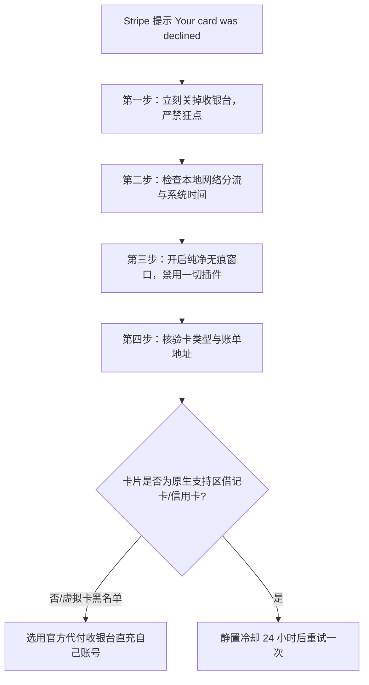

# ChatGPT "Your card was declined" 与 Stripe 3DS 拒付深度排查（2026 最新版）

> 在线排查工具：[AI 订阅网络与环境体检工具箱（免安装即用）](https://imzyw.github.io/ai-subscription-doctor/)  
> 适用场景：ChatGPT Plus / Pro 升级时提示 `Your card was declined`、`We are unable to authenticate your payment method`、`Card has expired`、Stripe 收银台无限弹窗报错。

---

## 一、Stripe 与 OpenAI 核心拒付机制拆解

在 2026 年，ChatGPT 的订阅由全球顶级支付网关 **Stripe Billing & Radar** 托管。每一次点击“Subscribe”，后台会在毫秒级执行多层风控交叉核验：

| 校验层级 | 触发指标 | 常见报错代码 / 现象 | 为什么国内卡直接被拒 |
| :--- | :--- | :--- | :--- |
| **发卡行（Issuer）** | 发卡地区是否受限、是否支持国际在线无卡免密扣款 | `do_not_honor` / `generic_decline` | 国内银联、双币信用卡被发卡行外汇管制或非支持国规则自动拦截 |
| **Stripe Radar** | IP 纯净度、机房代理黑名单、邮箱注册时间、卡 BIN 欺诈分 | `highest_risk_level` / `blocked` | 便宜的数据中心共享节点被万人刷单污染，卡头在黑名单库中 |
| **3DS 挑战（SCA）** | 3D Secure 双因子短信/App 验证跳转是否通畅 | `We are unable to authenticate...` | 浏览器广告拦截插件阻断 iframe 或系统时钟漂移导致签名超时 |
| **账单地址（AVS）** | 填写的 Zip Code 与信用卡预留账单地是否匹配 | `incorrect_zip` / `fraudulent` | 随意乱填免税州邮编但卡实际属于其他国家 |

---

## 二、遇到拒付时的“保命三原则”

1. **绝对不要连点第 3 次**：
   - 连续被拒 2 次后，Stripe Radar 会将该浏览器指纹、当前 IP 和账号放入临时欺诈观察池。如果连刷 4-5 次，该 OpenAI 账号将直接丧失所有绑定新卡资格，甚至导致账号被封禁（Deactivated）。
2. **切勿频繁更换不同卡头尝试**：
   - 在同一个 IP 下 10 分钟内换 3 张不同的虚拟卡，系统会直接将其判定为“撞库黑客行为”。
3. **核查系统时间与分流规则**：
   - 3DS 鉴权要求客户端系统时间与全球原子钟偏差不得超过 30 秒。本地网络分流如果把 `pay.openai.com` 走香港而 `checkout.stripe.com` 走美国，必定 100% 拒付。

---

## 三、4 步标准排查与修复流程

### 步骤 1：排查网络分流一致性
确保你的代理规则中，以下域名严格走同一个支持区（如美国、日本或新加坡）节点：
- `chatgpt.com`
- `auth.openai.com`
- `pay.openai.com`
- `checkout.stripe.com`
- `*.stripe.com`

*注：如果其中某个域名漏走规则直连国内或落入香港节点，Stripe 会直接识别为高危跨国盗刷。*

### 步骤 2：校准本机系统时间
- **macOS**：系统设置 -> 通用 -> 日期与时间 -> 开启“自动设定时间”。
- **Windows**：设置 -> 时间和语言 -> 日期和时间 -> 点击“立即同步”。

### 步骤 3：无痕模式排除插件干扰
- 关闭广告拦截扩展（如 AdGuard、uBlock Origin），它们经常拦截 Stripe 嵌入的 3DS 认证 iframe。
- 使用 Chrome / Edge 的全新无痕窗口（Incognito Window）进行操作。

### 步骤 4：确认卡片状态与可用额度
- 必须确保卡内至少有 **$21 以上的余额**（Stripe 会在正式扣款前发起 $0 或 $1 的预授权扣款测试）。
- 账单地址（Billing Address）优先填写免税州有效地址（如 Oregon 俄勒冈、Delaware 特拉华、Montana 蒙大拿），邮编必须真实有效。

---

## 四、常见疑问解答

- **Q：提示 `We are unable to authenticate your payment method` 怎么解？**  
  A：这通常是 3DS 弹窗加载失败。检查代理软件的 UDP/QUIC 代理开关，临时关闭 QUIC 协议重试，或者关闭所有浏览器脚本扩展。
- **Q：为什么很多虚拟信用卡（如 5347、4859 等卡段）以前能用现在被拒？**  
  A：Stripe Radar 会定期拉黑高欺诈率的虚拟卡发行 BIN 码。一旦某个号段被薅羊毛严重，整个卡段将被 OpenAI 整体拉黑。

---

## 五、延伸阅读与相关资源

- 📖 **官方公开维基完整指南**：[飞书公开知识库（免登录直达）](https://ucnsm4aewnst.feishu.cn/wiki/YsP9wCWNBidKl3kvHS3c34tjnMf)
- ⚡ **更多支付报错急救秒查**：[全平台 AI 订阅报错雷达](https://gpt.imzyw.com/)
- 🛒 **不想折腾外卡与风控？**  
  无需外币信用卡、不交密码、支持支付宝/微信/USDT，2 分钟全自动充值自己账号：
  👉 [ChatGPT Plus / Pro 官方正规代付收银台](https://gpt.gptyw.pro/?utm_source=github&utm_medium=doc&utm_campaign=card-declined)
