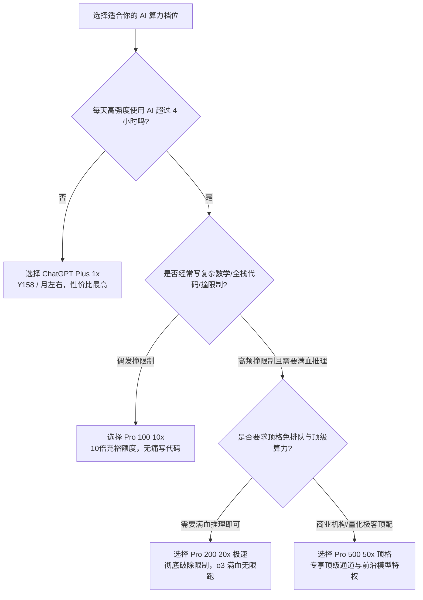

# 2026 ChatGPT 官方档位深度评测：Plus / Pro 100 (10x) / Pro 200 (20x) / Pro 500 (50x) 算力选型指南

> 在线排查工具：[AI 订阅网络与环境体检工具箱（免安装即用）](https://imzyw.github.io/ai-subscription-doctor/)  
> 适用场景：开发者、深度研究员、量化投资人及企业团队在选型 2026 年 OpenAI 官方订阅档位时的算力倍率、上下文窗口、破除 5 小时速率限制与成本决策。

---

## 一、2026 年 OpenAI 官方订阅矩阵横向全景

2026 年 OpenAI 彻底重构了个人与专业级订阅体系，从传统的单一 Plus 演进为覆盖轻度、重度、极速到顶格算力的多梯度矩阵：

| 档位名称 | 官方定价 | 相对 Plus 算力倍率 | 5 小时并发限制 | o1 / o3 深度推理权限 | 适用人群与核心价值 |
| :--- | :--- | :--- | :--- | :--- | :--- |
| **ChatGPT Plus** | $20/月 | **1x**（基准） | 40-80 次 / 3小时 | 标准思考时间，基础配额 | 日常办公、轻度内容创作、学生及普通开发者 |
| **ChatGPT Pro 100** | $100/月 | **10x** | 宽松上限，日常无感 | 高算力推理模式开启 | 职业独立开发者、论文深度科研、全天候高频编程 |
| **ChatGPT Pro 200** | $200/月 | **20x 极速** | 彻底取消 5 小时用量限制 | 满血 o3-pro 无限思考，支持顶格算力 | 商业分析团队、算法工程师、全栈重度极客 |
| **ChatGPT Pro 500** | $500/月 | **50x 顶格** | 顶格专属通道，零排队 | 优先抢先调度顶级实验模型 | 金融量化、核心架构设计、重度企业级私有算力需求 |

---

## 二、各大档位实测体验与核心差异

### 1. ChatGPT Plus（1x 基准档）
- **核心体验**：支持 GPT-4o 完整多模态交互、高级语音模式（Advanced Voice Mode）、Canvas 协同画布以及轻度 o1 推理能力。
- **痛点瓶颈**：在连续写复杂全栈项目或长篇架构设计时，经常触发“You have reached your current usage limit”提示，需要等待数小时冷却。

### 2. ChatGPT Pro 100（10x 高效生产力）
- **核心体验**：提供了 10 倍于 Plus 的模型调用配额，极大延展了深度思考模型的单次运算时长。
- **适合场景**：全天 8 小时以上重度使用 AI 辅助编码的工程师，告别每逢关键时刻就撞限制墙的尴尬。

### 3. ChatGPT Pro 200（20x 满血极速档）
- **核心体验**：
  - **完全解锁 o1-pro / o3 满血版**：允许模型投入更多的计算资源进行自我博弈与树状搜索推导，对于复杂数学、高难度并发架构 bug 诊断表现惊艳。
  - **彻底破除 5 小时次数限制**：高强度对话无须顾虑剩余次数。
  - **专属调度通道**：在晚高峰欧美高负荷时段，响应延迟比 Plus 降低 60% 以上。

### 4. ChatGPT Pro 500（50x 顶格尊享档）
- **核心体验**：专为追求极限效率的技术领袖和量化团队打造，拥有 OpenAI 顶级算力池的第一优先调度权，几乎等同于把一套超算节点作为私人副驾驶。

---

## 三、选型决策树：我到底该订哪个档位？

---

## 四、高频避坑提示

1. **不要盲目跳档升级**：如果平时仅用于润色英文邮件、翻译日常文档，Plus 档位已经完全绰绰有余。
2. **账号风控红线**：高阶档位（Pro 200 / 500）严禁多人跨地区异地拼车共享！OpenAI 对高价值账号的 IP 跳跃检测极其敏感，一旦检测到中美英三地同时并发调用，极易触发封控。
3. **充值路径安全**：Pro 级别由于单笔金额大（$100 - $500），使用便宜虚拟卡被拒付或风控会面临数百美元的资金冻结风险。

---

## 五、延伸阅读与相关资源

- 📖 **官方公开维基完整指南**：[飞书公开知识库（免登录直达）](https://ucnsm4aewnst.feishu.cn/wiki/YsP9wCWNBidKl3kvHS3c34tjnMf)
- ⚡ **更多支付报错急救秒查**：[全平台 AI 订阅报错雷达](https://gpt.imzyw.com/)
- 🛒 **不想折腾海外信用卡？**  
  无需外卡、不交密码、支持支付宝/微信/USDT，官方正规代付 2 分钟全自动充值自己账号：
  👉 [ChatGPT Plus / Pro 100 / Pro 200 / Pro 500 收银台](https://gpt.gptyw.pro/?utm_source=github&utm_medium=doc&utm_campaign=pro-comparison)
