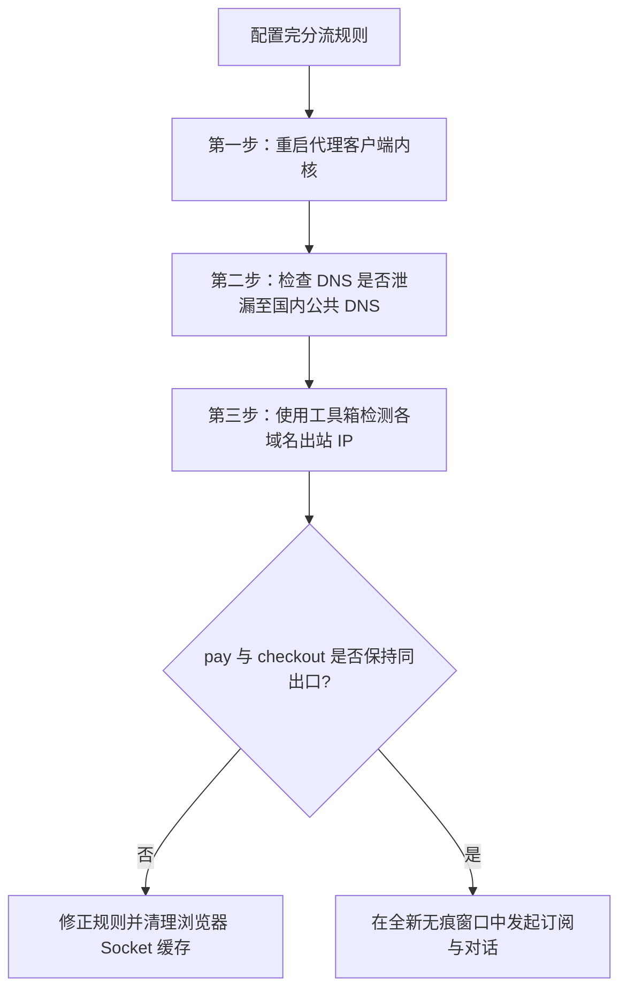

# Clash / Mihomo / Shadowrocket 防 403 防拒付分流规则配置指南（2026 实战版）

> 在线一键生成工具：[AI 订阅分流规则一键生成器（免安装即用）](https://imzyw.github.io/ai-subscription-doctor/)  
> 适用场景：访问 OpenAI / ChatGPT / Codex / Claude / Gemini 时出现 `403 User location is not supported`、Stripe 收银台加载不全、支付时报错 `Your card was declined` 或被拦截。

---

## 一、为什么 90% 的 403 与拒付源于“分流规则遗漏”？

在 2026 年，现代 AI 平台（特别是 OpenAI 和 Stripe）的前端架构高度微服务化：
- **认证入口**：`auth.openai.com`
- **主业务会话**：`chatgpt.com`
- **支付前置校验**：`pay.openai.com`
- **支付收银台核心**：`checkout.stripe.com`
- **静态资源与遥测**：`cdn.oaistatic.com`, `oaiusercontent.com`

**致命问题**：
很多开发者使用的通用规则集只代理了 `openai.com`，而将 `stripe.com` 走 DIRECT 直连，或者将 `pay.openai.com` 错误分流至香港节点（香港属于 OpenAI 非支持地区）。当 Stripe 发现用户的浏览器同时向美国出口和香港出口发送带有相同 Session 的握手包时，风控系统会判定为**跨国会话劫持（Session Hijacking）**，立即执行 403 阻断或发卡行拒付！

---

## 二、标准分流规则模板（全平台开箱即用）

### 1. Clash / Mihomo (Clash Meta) 规则片段

建议在你的配置文件中，为 AI 建立专属策略组（Proxy Group），例如命名为 `AI-Services`，指向美区、日区或新加坡原生节点：

```yaml
# 策略组定义示例
proxy-groups:
  - name: AI-Services
    type: select
    proxies:
      - 🇺🇸 美国原生节点
      - 🇯🇵 日本原生节点
      - 🇸🇬 新加坡原生节点

# 核心规则段（放在所有 GEOIP 和 MATCH 前面）
rules:
  # ================= OpenAI / ChatGPT / Codex =================
  - DOMAIN-SUFFIX,openai.com,AI-Services
  - DOMAIN-SUFFIX,chatgpt.com,AI-Services
  - DOMAIN-SUFFIX,oaistatic.com,AI-Services
  - DOMAIN-SUFFIX,oaiusercontent.com,AI-Services
  - DOMAIN-SUFFIX,sentry.io,AI-Services
  - DOMAIN,chat.openai.com,AI-Services
  - DOMAIN,auth0.openai.com,AI-Services
  - DOMAIN,platform.openai.com,AI-Services
  - DOMAIN,pay.openai.com,AI-Services

  # ================= Stripe 支付风控网关（极其关键） =================
  - DOMAIN-SUFFIX,stripe.com,AI-Services
  - DOMAIN-SUFFIX,stripe.network,AI-Services
  - DOMAIN,checkout.stripe.com,AI-Services
  - DOMAIN,api.stripe.com,AI-Services
  - DOMAIN,js.stripe.com,AI-Services

  # ================= Claude (Anthropic) =================
  - DOMAIN-SUFFIX,claude.ai,AI-Services
  - DOMAIN-SUFFIX,anthropic.com,AI-Services

  # ================= Google Gemini =================
  - DOMAIN-SUFFIX,gemini.google.com,AI-Services
  - DOMAIN-SUFFIX,aistudio.google.com,AI-Services
  - DOMAIN-SUFFIX,generativelanguage.googleapis.com,AI-Services

  # ================= xAI / Grok =================
  - DOMAIN-SUFFIX,x.ai,AI-Services
  - DOMAIN-SUFFIX,grok.com,AI-Services
```

### 2. Shadowrocket 规则配置

在 Shadowrocket 配置文件的 `[Rule]` 字段中添加：

```ini
# OpenAI & Stripe
DOMAIN-SUFFIX,openai.com,PROXY
DOMAIN-SUFFIX,chatgpt.com,PROXY
DOMAIN-SUFFIX,oaistatic.com,PROXY
DOMAIN-SUFFIX,oaiusercontent.com,PROXY
DOMAIN-SUFFIX,stripe.com,PROXY
DOMAIN-SUFFIX,stripe.network,PROXY

# Claude & Gemini
DOMAIN-SUFFIX,claude.ai,PROXY
DOMAIN-SUFFIX,anthropic.com,PROXY
DOMAIN-SUFFIX,gemini.google.com,PROXY
DOMAIN-SUFFIX,aistudio.google.com,PROXY
DOMAIN-SUFFIX,x.ai,PROXY
DOMAIN-SUFFIX,grok.com,PROXY
```

---

## 三、4 步连通性与一致性排查流水线



1. **禁用 QUIC / HTTP3 协议**：部分代理软件在处理 QUIC (UDP 443) 分流时存在漏包现象，导致部分流量直连。建议在客户端中关闭 QUIC 或在浏览器设置中停用实验性 QUIC。
2. **清除浏览器 DNS 与 Socket 连接**：
   - Chrome 地址栏输入 `chrome://net-internals/#sockets`，点击 `Flush socket pools`。
   - 打开无痕窗口，避免旧会话 Cookie 残留。
3. **验证出口纯净度**：使用 [AI 订阅体检箱](https://imzyw.github.io/ai-subscription-doctor/) 在线体检功能，核对 `auth.openai.com` 与 `checkout.stripe.com` 的握手出口状态。

---

## 四、延伸阅读与相关资源

- 📖 **官方公开维基完整指南**：[飞书公开知识库（免登录直达）](https://ucnsm4aewnst.feishu.cn/wiki/YsP9wCWNBidKl3kvHS3c34tjnMf)
- ⚡ **更多支付报错急救秒查**：[全平台 AI 订阅报错雷达](https://gpt.imzyw.com/)
- 🛒 **不想折腾网络规则与外卡？**  
  无需外卡、不交密码、支持支付宝/微信/USDT，2 分钟全自动充值自己账号：
  👉 [ChatGPT / Claude 正规代付收银台](https://gpt.gptyw.pro/?utm_source=github&utm_medium=doc&utm_campaign=clash-rules)
