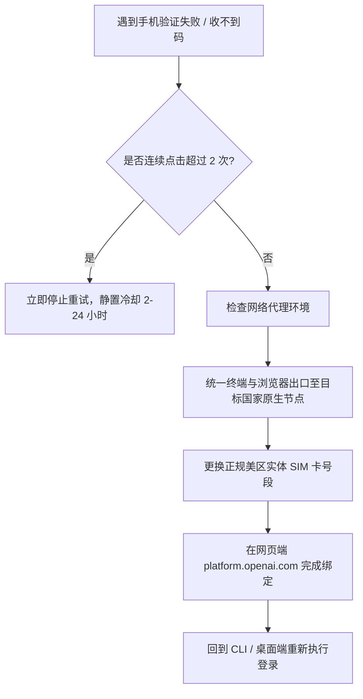

# Codex / OpenAI 手机收不到验证码？2026 美区实体卡排查与防风控实战

> 在线排查工具：[AI 订阅网络与环境体检工具箱（免安装即用）](https://imzyw.github.io/ai-subscription-doctor/)  
> 适用场景：Codex CLI 首次 OAuth 登录、ChatGPT 桌面端触发二次安全核验、OpenAI 开发者后台绑定手机时提示 `Unsupported phone number`、`Too many requests` 或迟迟收不到 6 位短信验证码。

---

## 一、为什么 2026 年 OpenAI / Codex 手机验证极易失败？

2026 年 OpenAI 对开发者 API 接口以及 Codex CLI 等高算力工具的手机号码核验采取了目前 AI 行业最严格的防风控策略：

1. **VOIP 与虚拟号段 100% 拦截（Carrier Lookup 穿透）**：
   - OpenAI 后端接入了 Twilio / Telesign 等顶级号码信誉库，能够毫秒级识别号码类型。
   - Google Voice、TextNow、Skype、Dingtone 以及市面上绝大部分基于软件协议的 VOIP 号码会被直接标记为 `Unsupported phone number`。
   - 公共免费接码平台的号码早已被数万人并发复用，不仅无法下发短信，甚至直接触发账号标记。
2. **IP 出口与号段属地跨区冲突**：
   - 如果你的浏览器或终端代理出口在欧洲或香港，却尝试绑定一个美国手机号，系统风控引擎会提高欺诈分值（Fraud Score），直接静默丢弃短信。
3. **连击触发短信静默冷却（Rate Limiting）**：
   - 10 分钟内点击 `Resend code` 超过 2 次，系统将启动 2 小时到 24 小时的静默熔断。在这期间哪怕输入完全正常的号码，也不会触发下发。

---

## 二、标准化排查与自救步骤



### 步骤 1：立即停手，确认冷却状态
- 凡是收到 `You have exceeded the maximum number of attempts` 或连续点击未见短信，**切忌更换号码反复狂刷**。
- 建议立即关闭网页，等待至少 2 小时；严重者建议静置 24 小时后再试。

### 步骤 2：对齐终端与浏览器网络环境
很多工程师在终端运行 `codex` 时，未配置终端代理，导致 CLI 直连而网页走代理，产生出口不一致：

```bash
# macOS / Linux 终端配置代理（以本地代理端口 7890 为例）
export HTTP_PROXY="http://127.0.0.1:7890"
export HTTPS_PROXY="http://127.0.0.1:7890"

# 检查终端当前公网 IP 是否为美国原生节点
curl -s https://api.ipify.org
```

### 步骤 3：选用正规美区实体 SIM 卡号段
- 必须使用真实移动运营商（如 T-Mobile、AT&T、Verizon 等基础设施号段）的真实实体卡。
- 单个实体号码仅限验证 1 个主力账号，切勿用于多个账号批量复用。
- 输入号码时切勿带国家前缀多余的 `0`，格式应为 `+1 (XXX) XXX-XXXX`。

### 步骤 4：网页端先解绑/绑定，CLI 再授权
1. 打开浏览器无痕窗口，登录 [platform.openai.com](https://platform.openai.com/) 或 [chatgpt.com](https://chatgpt.com/)。
2. 在个人资料或 API 设置页先完成号码校验。
3. 验证通过后，在终端运行 `codex login` 或启动桌面端，直接走 OAuth 授权完成握手。

---

## 三、高频踩坑 FAQ

- **Q：输入实体卡后提示 `Code expired or invalid` 怎么办？**  
  A：检查本地操作系统的时间偏差。如果本地电脑时间慢了 30 秒以上，OAuth 和 TOTP 校验就会超时失效。可以使用 [AI 订阅体检箱](https://imzyw.github.io/ai-subscription-doctor/) 一键测定系统时钟偏差。
- **Q：已经绑过手机的账号，换设备登录还会再要验证码吗？**  
  A：如果节点 IP 发生突变（例如从美国节点跳到香港或新加坡），或者浏览器指纹剧烈变动，系统会触发二次安全核验。保持节点稳定是关键。

---

## 四、延伸阅读与相关资源

- 📖 **官方公开维基完整指南**：[飞书公开知识库（免登录直达）](https://ucnsm4aewnst.feishu.cn/wiki/YsP9wCWNBidKl3kvHS3c34tjnMf)
- ⚡ **更多支付报错急救秒查**：[全平台 AI 订阅报错雷达](https://gpt.imzyw.com/)
- 🛒 **不想折腾海外手机号与外卡？**  
  如果你没有海外实体 SIM 卡或外币信用卡，无需四处找卡、不交密码、支持支付宝/微信/USDT，2 分钟全自动充值自己账号：
  👉 [ChatGPT / Codex 正规代付收银台](https://gpt.gptyw.pro/?utm_source=github&utm_medium=doc&utm_campaign=codex-sms)
