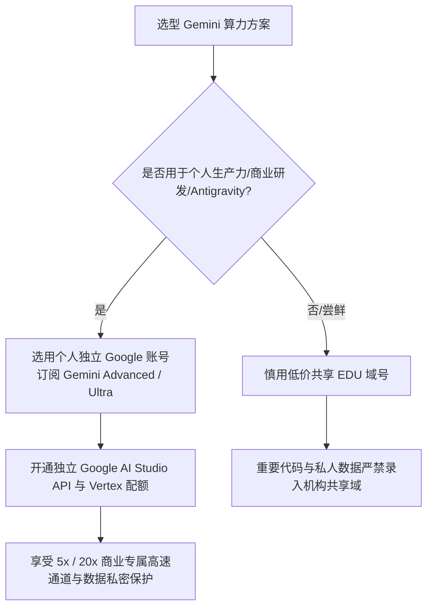

# Gemini 教育版与 Ultra 5x/20x 深度差异：Google Workspace 避坑与 Antigravity 兼容指南

> 在线排查工具：[AI 订阅网络与环境体检工具箱（免安装即用）](https://imzyw.github.io/ai-subscription-doctor/)  
> 适用场景：开发者在配置 Google AI Studio、Google Cloud Vertex AI 以及 Google Antigravity / Gemini CLI 时，选型 Gemini EDU 教育授权与 Gemini Advanced / Ultra 商业版算力时的避坑指南。

---

## 一、Gemini 教育版（EDU）与官方 Ultra 商业版的核心差异

市场上经常流通价格极低廉的所谓的“Gemini 教育号 / 学生认证号”，但对于追求稳定生产力的开发者和企业用户，两者存在本质的治理机制差异：

| 维度对比 | Google Workspace for Education (EDU 授权) | Gemini Advanced / Ultra (官方个人商业订阅) |
| :--- | :--- | :--- |
| **底层归属权** | **归属于学校/机构域名管理员（Super Admin）** | **归属于个人 Google 账号私有** |
| **数据隐私与审查** | 学校管理员有权随时审计、导出甚至删除所有对话 | 个人私有数据，不被第三方机构任意接管 |
| **存活周期与风险** | 极易因为学校域被 Google 集中封禁导致“连坐暴毙” | 官方按月扣款，稳定长效持有 |
| **API / Vertex 权限** | 绝大多数被学校管理员全局禁用了 Cloud 计费与 Vertex AI | 完整开放 Google AI Studio API Key 与 Cloud 配额 |
| **算力与并发配额** | 基础 1x 共享池，高峰期被严重限流 | 享有 5x / 20x 专属算力调度通道 |

---

## 二、Google Antigravity 与 Gemini CLI 兼容性实测避坑

在使用 Google Antigravity 开发环境或通过终端调用 Gemini 官方 SDK 时，使用教育号最常遇到的三大暗坑：

### 1. `PERMISSION_DENIED: Workspace administrator has disabled AI services`
- **成因**：许多批量注册的 EDU 账号并没有开通独立 GCP 项目的权限，或者管理员关闭了针对外部第三方的 OAuth 授权。
- **后果**：无法正常执行 `gcloud auth application-default login`，导致 Antigravity 插件和 CLI 工具在身份鉴权时直接抛出 403。

### 2. 模型上下文与多模态降级
- 官方 Gemini 1.5 Pro / Ultra 商业订阅支持高达 1M - 2M tokens 的超大上下文窗口；
- 部分 EDU 租户被限制在默认低配配额，长文本分析或复杂多模态视频/音频推理时会报错 `RESOURCE_EXHAUSTED`。

### 3. API 额度突然清零
- 很多“低价教育号”是利用漏洞批量扫号生成的黑产域，一旦被 Google 算法扫描到异常激活，整个域将在数小时内被全局停用，沉淀的代码与项目资产面临不可挽回的灭顶之灾。

---

## 三、生产环境推荐选型路径

### 最佳实践建议：
1. **私有账号独立绑定**：始终使用自己长期持有的私人 Google 账号（开启 2FA 两步验证）作为主体。
2. **区分开发与测试**：在本地 Antigravity 与自动化流水线中，配置官方商业授信，确保交付链路的确定性与连续性。

---

## 四、常见疑问解答

- **Q：Google One 赠送的 Gemini Advanced 和单独订阅有什么区别？**  
  A：两者底层模型权限一致，Google One 2TB+ 计划中附带的 Gemini Advanced 额外包含云存储空间，性价比极高。
- **Q：Antigravity 可以同时配置多个不同国家的 Google 账号吗？**  
  A：可以，但建议每个工作空间使用独立的 gcloud 配置配置隔离（Named Configurations），避免环境变量污染。

---

## 五、延伸阅读与相关资源

- 📖 **官方公开维基完整指南**：[飞书公开知识库（免登录直达）](https://ucnsm4aewnst.feishu.cn/wiki/YsP9wCWNBidKl3kvHS3c34tjnMf)
- ⚡ **更多支付报错急救秒查**：[全平台 AI 订阅报错雷达](https://gpt.imzyw.com/)
- 🛒 **不想折腾海外支付与 Google Play？**  
  无需外卡、不交密码、支持支付宝/微信/USDT，官方正规代付 2 分钟全自动充值自己账号：
  👉 [Gemini Advanced / Ultra 官方正规收银台](https://gemini.gptyw.pro/?utm_source=github&utm_medium=doc&utm_campaign=gemini-edu-ultra)
