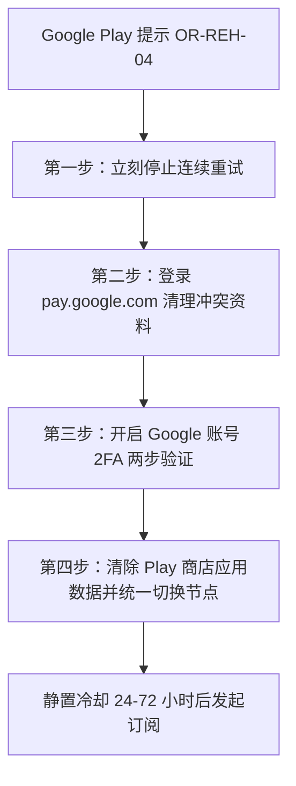

# Google Play 订阅 Gemini 报错 OR-REH-04 / OR-CCSEH-21 地区验证失败排查指南

> 在线排查工具：[AI 订阅网络与环境体检工具箱（免安装即用）](https://imzyw.github.io/ai-subscription-doctor/)  
> 适用场景：通过 Android Google Play 商店或网页端订阅 Google One / Gemini Advanced (Gemini Ultra) 时，提示 `[OR-REH-04]`、`[OR-CCSEH-21]`、`[OR-HDT-01]`、`Error retrieving information from server` 或付款方式无法验证。

---

## 一、Google Payments 底层风控原理

Google 针对 Google Play 与 Google One 支付环境设立了极度严密的全球欺诈检测体系。常见报错的具体成因如下：

| 错误代码 | 官方说明倾向 | 真实技术根因（2026 最新） |
| :--- | :--- | :--- |
| **`OR-REH-04`** | 付款资料异常 / 无法完成交易 | **付款资料国家与当前 IP 属地冲突**，或该 Google 账号存在多个不同国家的付款资料（如旧国区 profile 残留），触发风控死锁。 |
| **`OR-CCSEH-21`** | 卡片安全验证失败 | 发卡行 3DS 鉴权未通过、使用了非目标国发行的虚拟信用卡，或该卡号段被 Google 标记为高欺诈率。 |
| **`OR-HDT-01`** | 交易被拒绝 | 礼品卡充值跨区锁定（锁区锁卡），账号被判定跨区购买数字权益。 |

---

## 二、出现报错后的应急避险守则

1. **绝对不要短时间内反复添加/解绑银行卡**：
   - 1 小时内解绑、重绑超过 2 次，Google Payments 会将该账号打入长达 **14 天的冷冻期**。在此期间任何正规卡均无法添加。
2. **切勿盲目购买 Google Play 礼品卡充值**：
   - 从 2024 年至今，Google 对礼品卡跨区消费实施严格物理 IP 探测。跨区账号余额极易被锁死，无法用于消费 Gemini 或 Google One。
3. **彻底清理多余国家的付款资料**：
   - 90% 的 OR-REH-04 都是因为账号名下同时挂着“中国区付款资料”和“美国区付款资料”导致的路由冲突。

---

## 三、4 步标准修复流程

### 步骤 1：清理 Google 付款资料（关键步）
1. 电脑端浏览器打开无痕窗口，登录 [pay.google.com](https://pay.google.com/)。
2. 点击右上角 **设置（Settings）**。
3. 滚动到页面底部，检查 **“付款资料（Payments profile）”**。
4. 如果存在多个国家的资料，将所有非目标区（如旧中国区资料）彻底关闭，只保留唯一的目标国（如美国区）资料。

### 步骤 2：强化 Google 账号可信度
- 在 Google 账号安全中心开启 **两步验证（2-Step Verification）**。
- 绑定可用的备用邮箱与恢复手机，提升账号的 Trust Score（信任评级）。

### 步骤 3：手机端清理 Google Play 服务缓存（Android 设备）
1. 在手机系统设置中找到应用管理。
2. 依次选择 **Google Play Store（商店）** 和 **Google Play Services（服务）**。
3. 点击“强制停止”，然后点击“清除存储空间与缓存”。
4. 确保手机代理工具处于全局代理模式，且节点 IP 与付款资料国家严格一致。

### 步骤 4：静置冷却期
完成上述步骤后，**不要立刻点击付款**！建议让账号在统一的网络环境下静置冷却至少 **24 至 72 小时**。让 Google 安全模型刷新账号会话画像。

---

## 四、常见疑问解答

- **Q：网页端 pay.google.com 已经没有报错，为什么 Play 商店依然弹 OR-REH-04？**  
  A：因为 Android 本地 Google Play 缓存了之前的设备指纹。请务必完整清除 Play 商店和 Google Play 服务的本地数据，并重启设备。
- **Q：国内双币 Visa / Mastercard 可以绑 Google Play 订阅 Gemini 吗？**  
  A：绝大部分国内双币卡在 Google Play 美区消费都会触发发卡行或 Google 单向拒付，建议使用正规外币卡或免外卡的代充通道。

---

## 五、延伸阅读与相关资源

- 📖 **官方公开维基完整指南**：[飞书公开知识库（免登录直达）](https://ucnsm4aewnst.feishu.cn/wiki/YsP9wCWNBidKl3kvHS3c34tjnMf)
- ⚡ **更多支付报错急救秒查**：[全平台 AI 订阅报错雷达](https://gpt.imzyw.com/)
- 🛒 **不想折腾 Google Play 与多区冲突？**  
  无需外卡、不交密码、支持支付宝/微信/USDT，2 分钟全自动充值自己账号：
  👉 [Gemini Advanced / Google One 正规收银台](https://gemini.gptyw.pro/?utm_source=github&utm_medium=doc&utm_campaign=google-play-or-reh)
