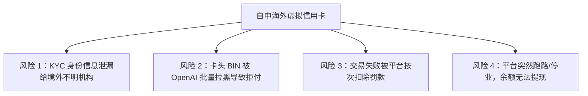

# 海外虚拟信用卡隐性成本大起底：开卡费/充值手续费/封卡沉淀与直充模式全对比

> 在线测算工具：[AI 订阅成本与综合费率速算器（免安装即用）](https://imzyw.github.io/ai-subscription-doctor/)  
> 适用场景：开发者在选用海外虚拟信用卡（Virtual Credit Card / VCC）订阅 ChatGPT Plus、Claude Pro、Midjourney、GitHub Copilot 时的真实账单核算。

---

## 一、虚拟信用卡看似“自由”背后的隐性吸血链条

许多初次接触海外 AI 订阅的开发者，常常被网络上所谓的“0 门槛开卡、轻松搞定 ChatGPT”教程所吸引。然而在 2026 年的实际使用中，虚拟卡平台的**真实综合成本**远超账面宣称：

| 费用类型 | 常见虚拟卡平台收费标准 | 订阅一个 $20 的 ChatGPT 实际付出 | 痛点说明 |
| :--- | :--- | :--- | :--- |
| **开卡工本费** | $5.00 - $10.00 / 张 | **$5.00 - $10.00**（首月即亏损） | 每开一张虚拟卡都要扣一次工本费，换卡头再扣一次 |
| **充值汇率滑点** | 实时汇率 + 2% - 5% | 约 ¥150 充进账户实际只有 $19.2 | 充值时存在严重的隐性汇差和 USDT OTC 损耗 |
| **充值手续费** | 3.0% - 6.0% / 笔 | 扣除 $0.60 - $1.20 | 每次往卡里打钱都要被平台抽一道流水 |
| **交易失败罚金** | **$0.50 / 次**（极度恶心） | 拒付 3 次直接被扣罚 $1.50 | 遇到卡段被 OpenAI 拉黑，每刷一次失败就倒扣钱 |
| **沉淀资金损耗** | 最低提现门槛 $50 或不可提现 | 卡里剩余 $3-$5 无法取出沉淀 | 平台跑路或注销时，零碎余额全部打水漂 |

> 真实账单算笔账：首月自申虚拟卡订阅一次 $20 的 ChatGPT Plus，**实际总支出往往高达 ¥190 - ¥230 元**，而且耗费大量实名认证（KYC）精力。

---

## 二、四大不可控致命风险

1. **KYC 隐私安全黑洞**：绝大多数境外虚拟卡平台要求上传身份证、护照或人脸活体，开发者个人隐私极易被转手流转。
2. **卡段大规模连坐拒付**：一旦某个号段（如某些已知的 5347、4859 卡段）出现大量薅羊毛被 Stripe Radar 标记，全平台所有用户的该卡段立刻集体瘫痪。
3. **沉淀资金无法赎回**：很多平台设定了极高的提现门槛或根本不支持提现，每次扣款剩下的零头只能被永久扣在平台上。

---

## 三、主流订阅方案综合对比矩阵

| 对比维度 | 海外虚拟信用卡 (VCC) | 苹果美区礼品卡 | 官方正规收银台代充自己账号 |
| :--- | :--- | :--- | :--- |
| **首月综合开销** | 约 ¥190 - ¥230 (含开卡费) | 约 ¥165 - ¥180 | **¥158 左右（全包实价）** |
| **支付便捷度** | 繁琐（需充 USDT/外汇） | 需切换美区 Apple ID | **微信/支付宝/USDT 秒付** |
| **账号与密码** | 自行填写，需防 3DS 报错 | 需输入 Apple ID 密码 | **无需交出密码，安全透明** |
| **风控拒付率** | 极高（易遇卡段拉黑） | 中等（易遇锁区封号） | **官方合规通道，零风控** |
| **时间成本** | 1 - 2 小时折腾与核验 | 30 分钟养号与下载 | **2 分钟全自动到账** |

---

## 四、延伸阅读与相关资源

- 📖 **官方公开维基完整指南**：[飞书公开知识库（免登录直达）](https://ucnsm4aewnst.feishu.cn/wiki/YsP9wCWNBidKl3kvHS3c34tjnMf)
- ⚡ **更多支付报错急救秒查**：[全平台 AI 订阅报错雷达](https://gpt.imzyw.com/)
- 🛒 **不想交开卡费与承担卡段风控？**  
  无需外卡、不交密码、支持支付宝/微信/USDT，2 分钟全自动充值自己账号：
  👉 [ChatGPT / Claude / Gemini 官方正规代付收银台](https://gpt.gptyw.pro/?utm_source=github&utm_medium=doc&utm_campaign=virtual-card-comparison)
